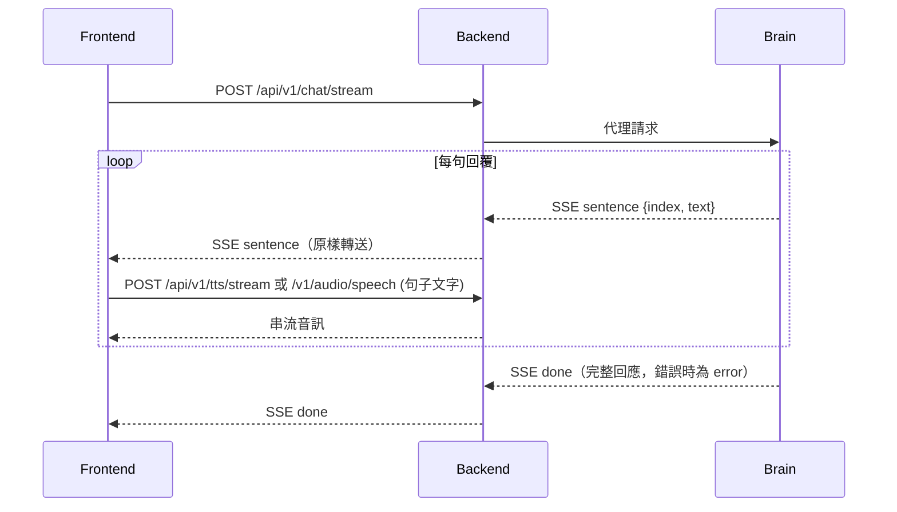
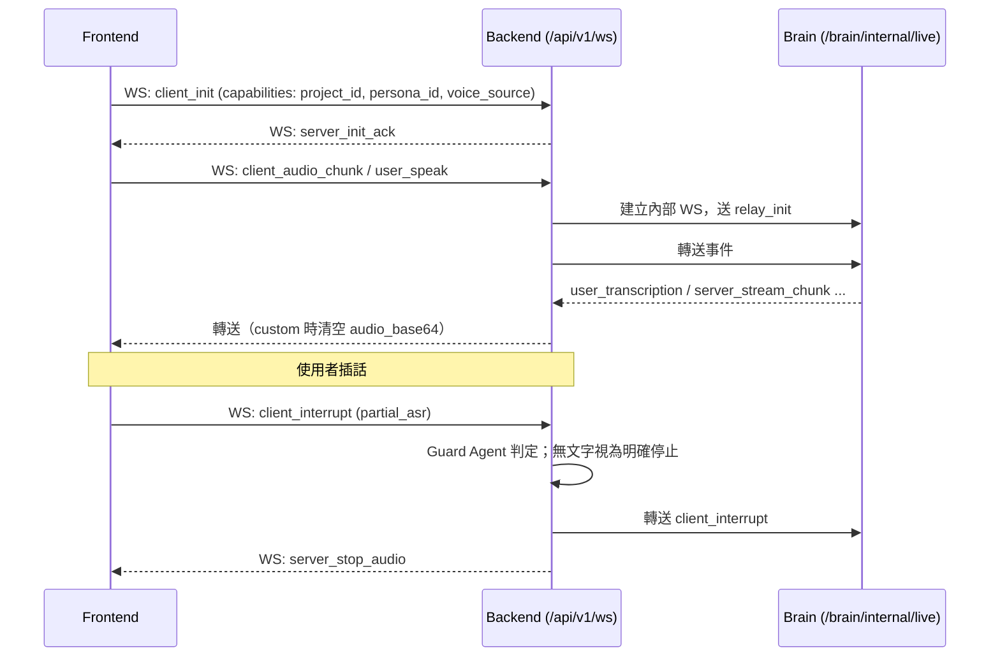
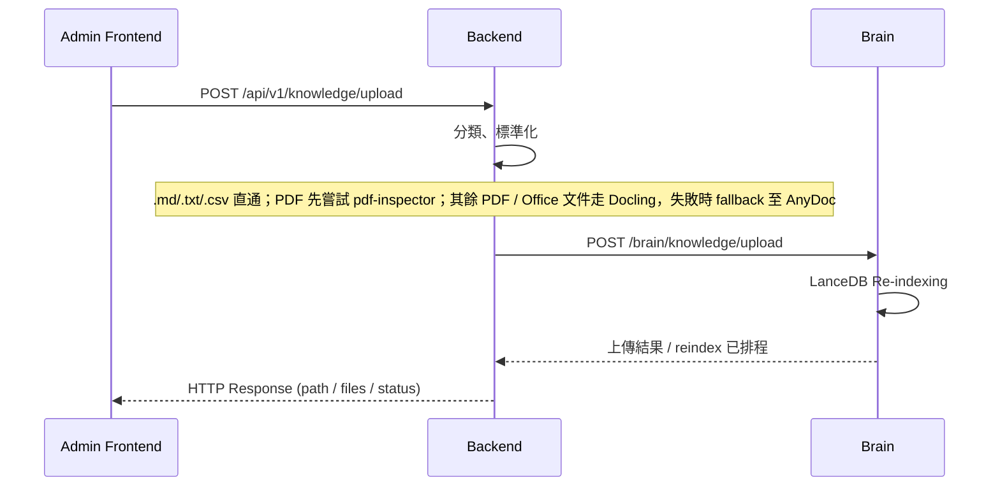

# 09_API_WS_LINKAGE.md
## 組件通訊與聯動規格 (API & WS Linkage Spec)

本文定義 openVman 各組件間的溝通邊界與時序邏輯。事件欄位的正式定義見 `00_CORE_PROTOCOL.md` 與 `contracts/schemas/v1/`。

### 1. 通訊地圖 (Communication Map)

| 源端 (From) | 目的端 (To) | 類型 | 說明 |
| :--- | :--- | :--- | :--- |
| Frontend | Backend `/api/v1/chat/stream`（`/api/v1/chat` 為非串流版本） | REST (POST, SSE) | 文字對話；Backend 代理至 Brain，逐句回傳回覆 |
| Frontend | Backend `/api/v1/tts/stream` 或 `/v1/audio/speech` | REST (POST) | 前端拿到回覆句子後自行請求語音合成；IndexTTS／VoxCPM 走串流 PCM 的 `/api/v1/tts/stream`，其他供應商走整段回傳的 `/v1/audio/speech` |
| Frontend | Backend `/api/v1/ws/{client_id}` | WebSocket | 即時語音（Gemini Live）：麥克風音訊、文字輸入、中斷、攝影機畫面 |
| Backend (`BrainLiveRelay`) | Brain `/brain/internal/live/{relay_session_id}` | WebSocket（內部） | 每個前端 Session 一條內部連線，帶 `X-Internal-Token` 與使用者／專案標頭 |
| Frontend / Admin | Backend Gateway Routes（`/api/v1/uploads`、`/api/v1/knowledge/*`） | REST (POST) | 文件／媒體檔案上傳 |
| Backend (Gateway Worker) | Backend (`/api/v1/internal/enrich`) | REST (POST) | 將媒體處理結果作為 enriched context 寫入指定 Session |
| Backend (`/api/v1/internal/enrich`) | Brain (`/internal/enrich`) | REST (POST) | 驗證 internal token 後轉發 enriched context |
| Backend (`/api/v1/knowledge/upload`) | Brain (`/brain/knowledge/upload`) | REST (POST) | 將標準化後的知識文件寫入 Brain 工作區並觸發背景索引 |

---

### 2. 關鍵時序圖 (Sequence Diagrams)

#### 2.1 文字對話流 (Text Chat Flow)
前端以 SSE 接收逐句回覆，每收到一句就排進語音合成佇列（一次一個請求，期間到達的句子併入下一個請求），依供應商呼叫 `/api/v1/tts/stream` 或 `/v1/audio/speech` 並播放；音訊 PCM 同時交給 avatar runtime 驅動嘴型。Chat 代理只轉送 Brain 的 SSE，不切句也不合成。

#### 2.2 即時語音流 (Live Voice Flow)
即時語音由 Brain 的 Gemini Live session 處理。Backend 的 `BrainLiveRelay`（`backend/app/gateway/brain_live_relay.py`）在收到第一個需要 Brain 的事件時建立內部 WebSocket，送出 `relay_init`，之後雙向轉送事件。

`client_init.capabilities.voice_source` 決定語音來源：`gemini`（預設）保留 Gemini 自己的音訊；`custom`（Vue 前台使用）會在轉送 `server_stream_chunk` 時清空 `audio_base64`，前端改用回覆文字自行請求語音合成，避免兩個聲音重疊。`voice_source`、`session_id`、`persona_id` 改變時，Backend 會關閉舊的 relay，下一個事件再重建。

#### 2.3 知識上傳流 (Knowledge Upload Flow)

原始檔另由 `POST /api/v1/knowledge/raw/upload` 轉送至 Brain 的 `/brain/knowledge/raw/upload`。

### 3. WebSocket 事件清單 (`/api/v1/ws/{client_id}`)

| 事件名稱 | 方向 | 說明 |
| :--- | :--- | :--- |
| `client_init` | C -> S | 交握；`capabilities` 帶 `project_id`、`persona_id`、`session_id`、`voice_source` |
| `server_init_ack` | S -> C | 交握確認，回 `session_id` |
| `user_speak` | C -> S | 文字輸入，轉送至 Brain live session |
| `client_audio_chunk` / `client_audio_end` | C -> S | 麥克風音訊，轉送至 Brain live session |
| `client_video_frame` / `client_camera_reset` | C -> S | 攝影機畫面與重置，交給 Backend 攝影機外掛 |
| `client_interrupt` | C -> S | 插話／停止；`partial_asr` 為空時直接停止 |
| `set_decision_debug` | C -> S | 開關前台決策 Debug，轉送至 Brain |
| `set_lip_sync_mode` | C -> S | 舊對嘴模式切換（`dinet`／`wav2lip`／`webgl`）；Vue 前台在 `server_init_ack` 後仍送 `webgl`，Backend 只記在 session，沒有程式讀取 |
| `user_transcription` | S -> C | 使用者語音轉寫 |
| `server_stream_chunk` | S -> C | 回覆文字（與 `gemini` 來源的音訊），`is_final` 標記結尾 |
| `server_stop_audio` | S -> C | 停止播放 |
| `server_camera_frame_status` | S -> C | 攝影機畫面處理狀態 |
| `server_error` | S -> C | 錯誤（例如專案不存在、Brain relay 斷線） |
| `ping` / `pong` | Both | 心跳，Backend 每 30 秒送 `ping` |

Brain live session 送出的其他事件（例如 `server_decision_debug`、`server_search_results`、`live_audio_language`）由 relay 原樣轉送。

對嘴由前端 avatar runtime 依播放中的 PCM 自行處理，不受任何 WebSocket 事件控制。
